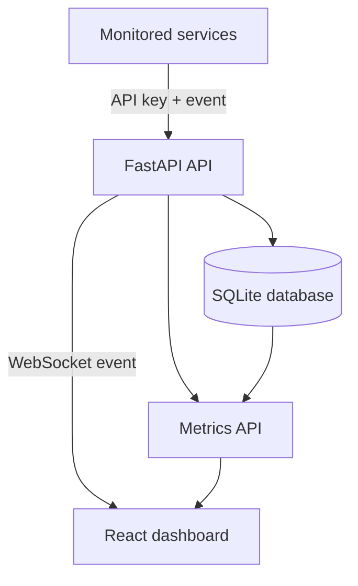

# PulseWatch

[](https://github.com/shahariarsahil42/pulsewatch/actions/workflows/ci.yml)

PulseWatch is a full-stack application monitoring platform that collects service events, calculates operational metrics, and streams new events to a live dashboard in real time.

The project demonstrates backend API development, database design, authentication, WebSockets, automated testing, responsive frontend development, containerization, and continuous integration.

## Features

- Secure event ingestion using API-key authentication
- Persistent event storage with SQLAlchemy and SQLite
- Event filtering by service name and severity level
- Monitoring metrics for:
  - Total events
  - Error count
  - Warning count
  - Average response time
  - Number of monitored services
- Real-time event delivery using WebSockets
- Responsive React and TypeScript dashboard
- Interactive FastAPI documentation
- Seven automated backend tests
- Frontend linting and production build validation
- Dockerized backend and frontend
- Persistent Docker database volume
- GitHub Actions continuous integration

## Technology Stack

### Backend

- Python 3.11
- FastAPI
- SQLAlchemy 2
- Pydantic
- SQLite
- WebSockets
- Pytest

### Frontend

- React
- TypeScript
- Vite
- CSS
- Nginx

### DevOps

- Docker
- Docker Compose
- GitHub Actions
- Git

## Architecture



A monitored application sends an event to the protected FastAPI endpoint. PulseWatch validates the API key, stores the event, updates aggregate metrics, and broadcasts the new event to every connected dashboard through a WebSocket.

## Quick Start With Docker

### Requirements

- Docker Desktop
- Docker Compose

### Start PulseWatch

From the project root, run:

```bash
docker compose up --build
```

Open the dashboard:

```text
http://localhost:5173
```

Open the API documentation:

```text
http://localhost:8000/docs
```

### Stop PulseWatch

Press `Control + C`, then run:

```bash
docker compose down
```

The database is stored in a named Docker volume, so events remain available after the containers restart.

## Run Locally Without Docker

### Backend

Create and activate a virtual environment:

```bash
python3 -m venv .venv
source .venv/bin/activate
```

Install dependencies:

```bash
pip install -r requirements.txt
```

Start the FastAPI server:

```bash
fastapi dev backend/app/main.py
```

The backend runs at:

```text
http://127.0.0.1:8000
```

### Frontend

Open another terminal:

```bash
cd frontend
npm install
npm run dev
```

The frontend runs at:

```text
http://localhost:5173
```

## API Authentication

The event ingestion endpoint requires an API key in the `X-API-Key` request header.

The default development key is:

```text
pulsewatch-development-key
```

For a custom key, set the `PULSEWATCH_API_KEY` environment variable before starting the application.

Never use the default development key in a production environment.

## Send a Monitoring Event

```bash
curl -X POST http://localhost:8000/events \
  -H "Content-Type: application/json" \
  -H "X-API-Key: pulsewatch-development-key" \
  -d '{
    "service_name": "checkout-api",
    "level": "error",
    "message": "Payment request timed out",
    "endpoint": "/api/payments",
    "response_time_ms": 2500
  }'
```

The event will be stored in the database and appear on the dashboard immediately through the WebSocket connection.

## API Endpoints

| Method | Endpoint | Description | Authentication |
| --- | --- | --- | --- |
| `GET` | `/` | API status message | No |
| `GET` | `/health` | Health check and timestamp | No |
| `POST` | `/events` | Create a monitoring event | API key |
| `GET` | `/events` | List and filter events | No |
| `GET` | `/metrics/summary` | Retrieve monitoring metrics | No |
| `WS` | `/ws/events` | Stream new events in real time | No |

## Event Levels

PulseWatch supports these severity levels:

- `debug`
- `info`
- `warning`
- `error`
- `critical`

## Testing

Run all backend tests:

```bash
python -m pytest -v
```

Run frontend linting:

```bash
cd frontend
npm run lint
```

Create a production frontend build:

```bash
npm run build
```

## Continuous Integration

The GitHub Actions workflow runs automatically for pushes and pull requests to `main`.

It performs two independent jobs:

1. Installs Python dependencies and runs the backend test suite.
2. Installs frontend dependencies, runs ESLint, and creates a production build.

## Project Structure

```text
pulsewatch/
├── .github/
│   └── workflows/
│       └── ci.yml
├── backend/
│   └── app/
│       ├── database.py
│       ├── main.py
│       ├── models.py
│       ├── schemas.py
│       ├── security.py
│       └── websocket_manager.py
├── frontend/
│   ├── src/
│   │   ├── App.css
│   │   ├── App.tsx
│   │   └── index.css
│   ├── Dockerfile
│   └── package.json
├── tests/
│   ├── test_events.py
│   └── test_health.py
├── compose.yaml
├── Dockerfile
├── requirements.txt
└── README.md
```

## Engineering Highlights

- Dependency injection keeps database sessions isolated and testable.
- Pydantic validates incoming monitoring events.
- SQL aggregation calculates dashboard metrics efficiently.
- WebSocket connections provide real-time updates without polling.
- API keys protect the event ingestion endpoint.
- Docker Compose starts the entire system with one command.
- Automated tests use an isolated in-memory SQLite database.
- CI validates both backend and frontend changes.

## Future Improvements

- PostgreSQL support for production deployment
- User accounts and role-based access control
- Configurable alerts and notification channels
- Historical charts and time-range filtering
- Service-level availability and latency tracking
- Distributed event processing with a message queue

## Author

**Shahariar Chowdhury Sahil**

- GitHub: [shahariarsahil42](https://github.com/shahariarsahil42)